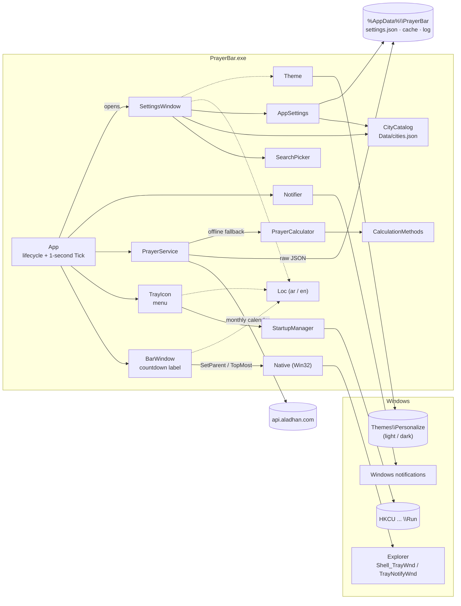

# PrayerBar — مواقيت الصلاة بجانب ساعة ويندوز

تطبيق صغير لـ Windows 11 يعرض **الصلاة القادمة مع عدّاد تنازلي حيّ** داخل شريط المهام، مباشرةً على يسار منطقة الساعة:

```
  الفجر            Fajr          ← سطران (الافتراضي)، مثل ساعة ويندوز 11
05:31:16        05:31:16

الفجر ⏳ 05:31:16              ← أو سطر واحد
```

- خط **عريض** افتراضياً، والأرقام أكبر وبعرض ثابت (لا يهتز العدّاد كل ثانية). الشكل والسماكة قابلان للتغيير من الإعدادات.

- يتحوّل النص إلى اللون **الكهرماني** عندما يتبقى أقل من 10 دقائق.
- إشعار (Toast) قبل كل صلاة بعدد دقائق تختاره.
- 244 دولة و6,521 مدينة مدمجة داخل البرنامج (بالعربية والإنجليزية) — تعمل بدون إنترنت.
- طريقة الحساب تُختار تلقائياً حسب الدولة (تركيا = ديانت، السعودية = أم القرى، …) مع إمكانية التغيير.
- واجهة بالعربية أو الإنجليزية، تتبع الوضع الفاتح/الداكن في ويندوز.
- ملف تنفيذي واحد (`PrayerBar.exe`)، استهلاك منخفض للمعالج (مؤقّت واحد كل ثانية).

> مكتوب بـ C# / .NET 8 / WPF. أسماء الأصناف والدوال في هذا الملف تبقى بالإنجليزية كما هي في الكود.

---

## الفهرس

1. [لقطات الشاشة](#لقطات-الشاشة)
2. [نظرة عامة على البنية](#نظرة-عامة-على-البنية)
3. [هيكل المشروع](#هيكل-المشروع)
4. [الأصناف والدوال بالتفصيل](#الأصناف-والدوال-بالتفصيل)
5. [جزء Win32 خطوة بخطوة](#جزء-win32-خطوة-بخطوة)
6. [كيف يعمل البرنامج في الخلفية](#كيف-يعمل-البرنامج-في-الخلفية)
7. [مواقيت الصلاة: المصدر، التخزين، الحساب دون اتصال، الدول والمدن](#مواقيت-الصلاة)
8. [كيف بنيتُه (سجل التطوير)](#كيف-بنيته-سجل-التطوير)
9. [البناء، التشغيل، النشر، الإزالة، حل المشاكل](#البناء-والتشغيل-والنشر)

---

## لقطات الشاشة

> ضع الصور في المجلد `docs/screenshots/` بالأسماء التالية.

| | |
|---|---|
|  |  |
| العدّاد بجانب الساعة (عربي) | العدّاد بالإنجليزية |
|  |  |
| نافذة الإعدادات (داكن، عربي) | نافذة الإعدادات (فاتح، إنجليزي) |
|  |  |
| البحث في قائمة المدن | إشعار قبل الصلاة |
|  |  |
| قائمة أيقونة شريط المهام | تلميح بمواقيت اليوم عند المرور بالفأرة |
|  |  |
| شكل السطرين | عادي / عريض / عريض جداً |

---

## نظرة عامة على البنية



**الفكرة باختصار:**

- `App` هو "القلب": لا توجد نافذة رئيسية. البرنامج يعيش في الخلفية، ويقوم كل شيء على **مؤقّت واحد** يعمل كل ثانية (`Tick`).
- `BarWindow` نافذة شفافة تُزرع داخل شريط المهام وتعرض النص.
- `PrayerService` يجلب مواقيت الشهر من Aladhan ويخزّنها، وإذا لم يتوفر إنترنت يحسبها محلياً عبر `PrayerCalculator`.
- `CityCatalog` قائمة الدول والمدن المدمجة، و`SettingsWindow` تتيح الاختيار منها.

---

## هيكل المشروع

```
prayer-bar/
├─ README.md                         ← هذا الملف
├─ .gitignore
├─ src/PrayerBar/                    ← التطبيق
│  ├─ PrayerBar.csproj               ← إعدادات المشروع (WPF + WinForms، الأيقونة، الموارد)
│  ├─ app.manifest                   ← DPI لكل شاشة (PerMonitorV2) + توافق Windows 10/11
│  ├─ app.ico                        ← الأيقونة (هلال ونجمة، مولّدة بالسكربت tools/make_icon.py)
│  ├─ App.xaml / App.xaml.cs         ← دورة حياة البرنامج، المؤقّت، تطبيق الإعدادات
│  ├─ BarWindow.xaml / .cs           ← نافذة العدّاد داخل شريط المهام + منطق التموضع
│  ├─ SettingsWindow.xaml / .cs      ← نافذة الإعدادات
│  ├─ SearchPicker.xaml / .cs        ← قائمة منسدلة مع بحث (للدول/المدن/الطريقة/التنبيه)
│  ├─ Themes/Controls.xaml           ← أنماط الأزرار والقوائم والمفاتيح (Fluent بسيط)
│  ├─ Theme.cs                       ← ألوان الوضع الفاتح/الداكن + لون التمييز في ويندوز
│  ├─ Loc.cs                         ← جدول النصوص بالعربية والإنجليزية
│  ├─ AppSettings.cs                 ← الإعدادات وحفظها في settings.json
│  ├─ CityCatalog.cs                 ← تحميل قائمة الدول والمدن + البحث المرن
│  ├─ Data/cities.json               ← البيانات المدمجة (مولّدة بالسكربت tools/build_cities.py)
│  ├─ CalculationMethods.cs          ← طرق الحساب الـ 23 في Aladhan ومعاملاتها
│  ├─ PrayerCalculator.cs            ← حساب المواقيت فلكياً دون اتصال
│  ├─ PrayerService.cs               ← جلب Aladhan، التخزين المؤقت، القراءة، السجل
│  ├─ TrayIcon.cs                    ← أيقونة منطقة الإشعارات وقائمتها
│  ├─ Notifier.cs                    ← الإشعارات (Toast)
│  ├─ StartupManager.cs              ← التشغيل مع ويندوز (مفتاح Run)
│  ├─ Native.cs                      ← تعريفات Win32 (P/Invoke)
│  └─ Properties/PublishProfiles/
│     ├─ SelfContained.pubxml        ← نشر: ملف واحد مستقل (لا يحتاج .NET)
│     └─ FrameworkDependent.pubxml   ← نشر: ملف واحد صغير (يحتاج .NET 8 Desktop Runtime)
├─ tests/PrayerBar.Tests/            ← اختبارات xUnit
│  ├─ PrayerTimesTests.cs            ← مقارنة الحساب المحلي مع ردود Aladhan الحقيقية
│  ├─ CityCatalogTests.cs            ← سلامة بيانات الدول والمدن والبحث
│  ├─ SettingsTests.cs               ← حفظ الإعدادات وتوافق الملفات القديمة
│  └─ Data/*.json                    ← أشهر كاملة من Aladhan (11 حالة: طرق ومدن مختلفة)
├─ tools/
│  ├─ build_cities.py                ← يولّد Data/cities.json من GeoNames + Wikidata + Aladhan
│  └─ make_icon.py                   ← يولّد app.ico
└─ publish/                          ← ناتج النشر (غير مُتتبَّع في git)
```

ملفات المستخدم (خارج المشروع):

| المسار | المحتوى |
|---|---|
| `%AppData%\PrayerBar\settings.json` | الإعدادات |
| `%AppData%\PrayerBar\cache\*.json` | ردود Aladhan الشهرية كما هي |
| `%AppData%\PrayerBar\cities.json` | (اختياري) مدن يضيفها المستخدم |
| `%AppData%\PrayerBar\log.txt` | سجل الأخطاء والأحداث المهمة (يُفرّغ عند 256KB) |

---

## الأصناف والدوال بالتفصيل

### `App` — ‏`App.xaml.cs`

نقطة البداية ودورة الحياة. `ShutdownMode="OnExplicitShutdown"` في `App.xaml` يعني أن إغلاق أي نافذة (أو تدمير نافذة العدّاد مع Explorer) **لا** ينهي البرنامج؛ فقط "خروج".

| الدالة | ماذا تفعل | المدخلات / المخرجات | لماذا بهذا الشكل |
|---|---|---|---|
| `OnStartup` | تتحقق من النسخة الوحيدة، تفعّل الرسم البرمجي، تحمّل الإعدادات واللغة والثيم، تنشئ الأيقونة ونافذة الرسائل والعدّاد، وتبدأ المؤقّت وأول تحديث | `StartupEventArgs` (يدعم `--uninstall`) | كل التهيئة في مكان واحد وبترتيب واضح |
| `Uninstall` | يحذف مفتاح التشغيل، تسجيل الإشعارات، ومجلد `%AppData%\PrayerBar` | — | ليبقى حذف الـ exe هو الخطوة الوحيدة المتبقية |
| `ShowTopmostMessage` | رسالة تظهر فوق كل النوافذ | نص + أيقونة | لا توجد نافذة رئيسية تملك الرسالة، فقد تظهر خلف التطبيقات |
| `CreateMessageWindow` | نافذة مخفية (top-level) تستقبل `TaskbarCreated` | — | رسالة `TaskbarCreated` تُبث للنوافذ العليا فقط، ونافذة العدّاد المزروعة تموت مع Explorer |
| `MessageHook` | يعالج `TaskbarCreated` (إعادة إنشاء العدّاد) و`WM_DISPLAYCHANGE`/`WM_SETTINGCHANGE`/`WM_DPICHANGED` (إعادة التموضع فوراً) | رسائل Win32 | لا ننتظر الثانية التالية عند تغيّر الدقة |
| `CreateBar` / `RecreateBar` / `OnBarClosed` | إنشاء نافذة العدّاد أو هدمها وإعادة بنائها | — | إعادة البناء أبسط وأوثق من "إصلاح" نافذة اختفى أبوها |
| `BuildSchedule` | يحمّل مواقيت اليوم والغد ويجهّز قائمة الصلوات القادمة | تاريخ المدينة | وجود الغد يعني أن ما بعد العشاء يعدّ تلقائياً إلى فجر الغد |
| `RefreshAsync` | يجلب الأشهر الناقصة (أو كلها مع `force`) ثم يعيد بناء الجدول؛ الطلبات أثناء جلب آخر تُصفّ ولا تُهمل | `force`, `announce` | تغيير المدينة أثناء تحميل لا يضيع |
| `Tick` | كل ثانية: اكتشاف منتصف الليل، النص، اللون، الإشعار، إعادة المحاولة، تموضع العدّاد | — | المهمة الدورية الوحيدة في البرنامج ← استهلاك منخفض |
| `MaybeNotify` | يُظهر إشعاراً واحداً لكل صلاة ضمن المهلة | الصلاة القادمة + المتبقي | مجموعة `_notified` تمنع التكرار |
| `UpdateBarToolTip` | التلميح: المدينة، التاريخ، المواقيت الستة، والمصدر | — | المستخدم يعرف إن كانت الأوقات من Aladhan أو محسوبة محلياً |
| `ShowSettings` / `ApplySettings` | يفتح الإعدادات ويطبّق المحفوظ فوراً: حساب محلي فوري ثم تحميل إجباري للمدينة الجديدة | `AppSettings` | لا يظهر العدّاد بمواقيت المدينة القديمة ولو لثانية |
| `ApplyLanguage` | يعيد تسمية القائمة والتلميح والعدّاد | — | تبديل اللغة يظهر مباشرة |

### `BarWindow` — ‏`BarWindow.xaml.cs`

نافذة بلا إطار، شفافة، بدون زر في شريط المهام، لا تأخذ التركيز. لها ثلاثة أوضاع (`BarMode`):

| الوضع | المعنى |
|---|---|
| `Embedded` | نافذة ابن (child) داخل `Shell_TrayWnd` عبر `SetParent` — الأفضل |
| `Overlay` | نافذة `TopMost` فوق شريط المهام في نفس المكان (إذا رفض Explorer الـ SetParent) |
| `Floating` | "حبة" صغيرة فوق شريط المهام مباشرةً إذا كان شريط المهام يغطي حتى النوافذ TopMost |

| الدالة/الخاصية | ماذا تفعل |
|---|---|
| `OnSourceInitialized` | يضيف `WS_EX_TOOLWINDOW` (بدون زر/Alt-Tab) و`WS_EX_NOACTIVATE` (لا يسرق التركيز)، ثم `TryAttach` و`Reposition` |
| `TryAttach` | يبدّل `WS_POPUP` إلى `WS_CHILD` ثم `SetParent(hwnd, Shell_TrayWnd)`؛ عند الرفض يعيد النمط ويسجّل رقم الخطأ |
| `Reposition` | يُستدعى كل ثانية: يقيس شريط المهام و`TrayNotifyWnd`، يحسب الحجم بالبكسل الفعلي (`DpiScale`)، ويضع النافذة يسار منطقة الإشعارات. في وضع الابن يحوّل الإحداثيات إلى إحداثيات الأب (`MapWindowPoints`) |
| `UpdateOverlayOrFloating` / `IsOnTopAt` | يكتشف عبر `WindowFromPoint` إن كانت نافذتنا مغطاة فعلاً، فينتقل إلى `Floating`، ويختبر كل 15 ثانية العودة |
| `ShouldHideOverTaskbar` | في الأوضاع المنبثقة: يخفي العدّاد إذا كان شريط المهام مخفياً تلقائياً أو تطبيق بملء الشاشة |
| `HideBar` | إخفاء بدون تدمير |
| `SetContent` | يضع اسم الصلاة والعدّاد، واللون (أبيض/أسود حسب لون شريط المهام، كهرماني للتحذير) واتجاه الكتابة. في وضع السطر الواحد يضيف الفاصل "⏳" |
| `ApplyStyle` | سطران (الاسم 12px فوق، الأرقام 14px تحت) أو سطر واحد، وسماكة الخط: `Normal` / `Bold` / `Black` |
| `SetToolTip` | التلميح بنفس اتجاه اللغة |
| `ApplyTheme` / `ApplyModeVisuals` | لون النص حسب **وضع ويندوز** (شريط المهام)، وخلفية الحبة في وضع `Floating` |
| `IsOrphaned` / `IsAttachedTo` / `DpiMismatch` | يخبر `App` متى يجب إعادة بناء النافذة (Explorer أُعيد تشغيله، أو تغيّر DPI) |

### `SettingsWindow` — ‏`SettingsWindow.xaml.cs`

تعمل على **نسخة مسودة** (`_draft`) من الإعدادات؛ لا يُطبَّق شيء إلا بالحفظ. الاستثناء: تبديل اللغة يظهر مباشرة (ويُلغى إذا ضغطت "إلغاء").

| الدالة | ماذا تفعل |
|---|---|
| المُنشئ | يملأ القيم، يجعل النافذة TopMost لحظة الفتح ثم `SetForegroundWindow` (لأن برنامجنا ليس في الواجهة عادةً)، ويجعل Esc يغلق القائمة المنسدلة فقط |
| `ApplyLanguage` | يضبط كل النصوص واتجاه النافذة، ويعيد بناء القوائم مع الحفاظ على الاختيار. الدول مرتّبة أبجدياً بلغة الواجهة |
| `FillCities` | مدن الدولة المختارة (الأكبر أولاً) |
| `FillMethods` | "تلقائي — (طريقة الدولة)" ثم كل الطرق |
| `UpdatePreview` | سطر "اليوم: الفجر 05:11 · …" محسوب محلياً فوراً للاختيار الحالي |
| بطاقة "المظهر" | شكل العدّاد (سطران / سطر واحد) وسماكة الخط (عادي / عريض / عريض جداً)؛ كل خيار مكتوب بسماكته ليُرى الفرق |
| `OnCountryChanged` | يختار أكبر مدينة في الدولة الجديدة ويحدّث تسمية "تلقائي" |
| `OnSave` | يتحقق، يحفظ `settings.json`، ويعيد النتيجة لـ `App` |

### `SearchPicker` — ‏`SearchPicker.xaml.cs`

قائمة منسدلة قابلة للبحث: زر يعرض الاختيار، وعند الضغط نافذة منبثقة فيها مربع بحث وقائمة مفلترة.

- **لماذا ليس `ComboBox` قابل للتحرير؟** لأن WPF يكمل النص تلقائياً ويستبدله أثناء الكتابة، وهذا يتعارض مع الفلترة ومع الكتابة بالعربية.
- `PickerItem(Value, Primary, Secondary)`: الاسم بلغة الواجهة + الاسم باللغة الأخرى باهتاً. `SearchKey` يُحسب مرة واحدة لتبقى الفلترة فورية.
- `ApplyFilter`: يطابق بعد "طي" النص (`CityCatalog.Fold`) ويضع المطابقات من البداية أولاً ("is" ← Istanbul قبل Kilis).
- لوحة المفاتيح: ↑/↓ للتنقل أثناء الكتابة، Enter للاختيار، Esc للإغلاق.

### `CityCatalog`, `Country`, `City` — ‏`CityCatalog.cs`

| العنصر | الوصف |
|---|---|
| `Instance` | تحميل كسول مرة واحدة من المورد المدمج `PrayerBar.Data.cities.json` |
| `Load` / `Merge` | يدمج ملف المستخدم `%AppData%\PrayerBar\cities.json` فوق المدمج: دول جديدة تُضاف، ومدن الدولة الموجودة تُضاف أو تُستبدل (بالاسم الإنجليزي)، و`method` غير الصفري يغيّر طريقة الدولة |
| `FindCountry` / `FindCity` | بحث بالرمز ISO والاسم الإنجليزي |
| `Fold` | تطبيع للبحث: أحرف صغيرة، إزالة التشكيل والعلامات اللاتينية (Şanlıurfa ≈ sanliurfa)، توحيد أ/إ/آ←ا، ة←ه، ى←ي، وحذف التطويل |

### `CalculationMethods`, `CalculationMethod`, `AsrSchool` — ‏`CalculationMethods.cs`

جدول بطرق Aladhan الـ 23: زاوية الفجر، زاوية العشاء **أو** دقائق بعد المغرب (أم القرى 90 دقيقة)، زاوية المغرب (طهران/الشيعة) أو دقائق بعد الغروب (البرتغال، الأردن)، والإزاحات المدمجة التي يطبّقها Aladhan لبعض الطرق (تركيا: الشروق −7، الظهر +5، العصر +4، المغرب +7؛ دبي؛ المغرب؛ البرتغال). هذه القيم استُخرجت من `/v1/methods` ومن `meta.offset` في ردود حقيقية.

### `PrayerCalculator` — ‏`PrayerCalculator.cs`

`Compute(date, lat, lng, tz, method, school) → List<PrayerTime>` (ستة أوقات كلحظات مطلقة `DateTimeOffset`).

نقل لخوارزمية PrayTimes.org (وهي نفس نموذج Aladhan) بنفس ترتيب العمليات حتى تتطابق النتائج:

1. حساب كل وقت من موقع الشمس (`SunPosition`: الميل ومعادلة الزمن) مع جولة تحسين واحدة.
2. تحويل التوقيت الشمسي المحلي إلى ساعة المنطقة الزمنية (مع التوقيت الصيفي لذلك اليوم).
3. تصحيح خطوط العرض العليا بطريقة الزاوية (`AdjustHighLat`).
4. المغرب/العشاء بالدقائق إن كانت الطريقة كذلك.
5. إزاحات الطريقة ثم التقريب لأقرب دقيقة.

الدوال المساعدة: `MidDay` (الزوال)، `SunAngleTime` (متى تكون الشمس تحت الأفق بزاوية معيّنة)، `AsrTime` (ظل الشيء = ظله عند الزوال + 1 أو 2 من طوله)، `Julian` (اليوم اليولياني).

**الدقة:** الاختبارات تقارن شهراً كاملاً لـ 11 حالة (غازي عنتاب ×2، الرياض، دبي، الدار البيضاء، لشبونة، طهران، عمّان، كراتشي-حنفي، لندن وأوسلو في يونيو) — كل الأوقات ضمن دقيقة واحدة من Aladhan.

### `PrayerService` — ‏`PrayerService.cs`

| الدالة | الوصف |
|---|---|
| `GetDay(date) → (Times, FromApi)` | من الذاكرة/الملف المخزّن إن وُجد، وإلا حساب محلي بنفس الطريقة والمذهب |
| `RefreshAsync(today, force) → bool` | يجلب شهر اليوم وشهر الغد (لأن فجر الغد قد يكون في الشهر التالي)، يتحقق من صحة الرد **قبل** استبدال الملف، يكتب بشكل ذرّي (ملف مؤقت ثم نقل) |
| `CachePath` | اسم الملف = الدولة_المدينة_mالطريقة_sالمذهب_السنة-الشهر.json؛ أي تغيير ينتج ملفاً مختلفاً |
| `PruneCache` | يحذف الملفات غير المستخدمة منذ 60 يوماً |
| `Parse(json, tz)` | يحوّل رد Aladhan إلى أيام؛ ينقل المغرب/العشاء التي بعد منتصف الليل إلى اليوم التالي |
| `ParseTiming` / `TryParseOffset` | يقرأ "05:11 (+03)"، وإذا كانت اللاحقة اختصاراً مثل "(BST)" يستخدم `TimeZoneInfo` للمدينة |
| `CityToday` | تاريخ اليوم **في منطقة المدينة** وليس منطقة الجهاز |
| `Log` | سجل بسيط لا يرمي استثناءات |

### `AppSettings` — ‏`AppSettings.cs`

الخصائص المحفوظة: `Language`, `Country`, `City`, `Latitude`, `Longitude`, `TimeZoneId`, `MethodOverride`, `AsrSchool`, `NotifyMinutes`, `EmbedInTaskbar`, `BarLayout` (`TwoLines`/`OneLine`), `BarWeight` (`Bold`/`ExtraBold`/`Normal`).
القيم التعدادية للمظهر تُحفظ **بالاسم** (`"Bold"`) لا بالرقم، ليبقى الملف مقروءاً ولا يتغير معناه إذا أُعيد ترتيب القيم.
الخصائص المحسوبة (`[JsonIgnore]`): `IsArabic`, `TimeZone` (مخزّنة مؤقتاً لأن تحويل معرّف IANA مكلف)، `Method` (الاختيار اليدوي وإلا طريقة الدولة).
`Save` ذرّي، `Load` يعود للقيم الافتراضية إذا كان الملف تالفاً، `SetCity` ينسخ الإحداثيات والمنطقة الزمنية من الكتالوج.

### `Loc` — ‏`Loc.cs`

جدول نصوص (إنجليزي، عربي) بسيط. `T(key, args)` و`Name(prayer)` و`Minutes(n)` (تمييز العدد بالعربية: دقيقة واحدة، دقيقتين، 3–10 دقائق، 11+ دقيقة). **لماذا ليس ملفات resx؟** لتبقى اللغة قابلة للتبديل لحظياً ولا تُضاف ملفات DLL للغات بجانب الـ exe.

### `Theme` — ‏`Theme.cs`

- يقرأ `AppsUseLightTheme` (للنوافذ) و`SystemUsesLightTheme` (لشريط المهام؛ قد يختلفان!).
- يبني قاموس ألوان (`Brush.*`) ويستبدله عند تغيّر الوضع، والأنماط في `Themes/Controls.xaml` تستخدم `DynamicResource` فتتغير النوافذ المفتوحة فوراً.
- لون التمييز من `UISettings` بالدرجة التي يستخدمها ويندوز نفسه (أفتح على الداكن، أغمق على الفاتح).
- `ApplyTitleBar`: شريط عنوان داكن عبر `DwmSetWindowAttribute(DWMWA_USE_IMMERSIVE_DARK_MODE)`.

### `TrayIcon` — ‏`TrayIcon.cs`

`NotifyIcon` من WinForms (لا يوجد بديل في WPF)، وميزته أنه يعيد إضافة نفسه تلقائياً بعد إعادة تشغيل Explorer. القائمة: سطر الحالة، الإعدادات، التشغيل مع ويندوز (✓ يُقرأ من السجل عند كل فتح)، تحديث الأوقات، خروج. `ApplyTheme` يرسم القائمة بألوان داكنة/فاتحة لأن قوائم WinForms تتجاهل الوضع الداكن.

### `Notifier`, `StartupManager`, `Native`

- `Notifier.Show`: إشعار Toast عبر `Microsoft.Toolkit.Uwp.Notifications`؛ إذا فشل يستخدم فقاعة `NotifyIcon` (تظهر كإشعار أيضاً في Windows 11).
- `StartupManager`: `IsEnabled` / `SetEnabled` على `HKCU\Software\Microsoft\Windows\CurrentVersion\Run`، و`RefreshPathIfEnabled` يصحح المسار إذا نُقل الـ exe.
- `Native`: كل تعريفات Win32 في مكان واحد ليسهل مراجعتها.

---

## جزء Win32 خطوة بخطوة

### 1. إيجاد شريط المهام والساعة

```csharp
var taskbar = FindWindow("Shell_TrayWnd", null);                    // شريط المهام الرئيسي
var tray    = FindWindowEx(taskbar, IntPtr.Zero, "TrayNotifyWnd", null); // الأيقونات + الساعة
GetWindowRect(taskbar, out var tb);
GetWindowRect(tray, out var anchor);
```

في Windows 11 **الساعة نفسها ليست نافذة** (تُرسم بـ XAML)، لذلك المرجع هو `TrayNotifyWnd` الذي يضم الأيقونات المخفية (^) والشبكة والصوت والساعة. نضع العدّاد على يساره مباشرةً:
`x = anchor.Left − عرض_العدّاد − 4` و`y` في منتصف ارتفاع شريط المهام.

### 2. `SetParent` أولاً، ثم `TopMost` كبديل

```csharp
style = (style | WS_CHILD) & ~WS_POPUP;     // نافذة ابن، لا منبثقة
SetWindowLongPtr(hwnd, GWL_STYLE, style);
SetParent(hwnd, taskbar);
```

- **عند النجاح (`Embedded`):** النافذة جزء من شريط المهام؛ تتحرك وتختفي معه (الإخفاء التلقائي يعمل تلقائياً)، ولا صراع على الترتيب. الإحداثيات تصبح نسبية للأب (`MapWindowPoints`). كل ثانية `SetWindowPos(HWND_TOP)` لأن جسر XAML في شريط المهام قد يُعاد ترتيبه فوقنا.
- **عند الرفض (`Overlay`):** نعيد النمط الأصلي ونصبح نافذة `TopMost`. كل ثانية نعيد `SetWindowPos(HWND_TOPMOST, x, y)` لأن الضغط على شريط المهام يرفعه فوقنا. ونخفي العدّاد بأنفسنا إذا كان شريط المهام مخفياً (نقارن مستطيله بمستطيل الشاشة) أو هناك تطبيق بملء الشاشة. ونعيد محاولة `SetParent` كل 15 ثانية.
- **إذا بقيت مغطاة (`Floating`):** نتحقق بـ `WindowFromPoint` من النافذة الظاهرة فعلاً في مركز العدّاد؛ إن كانت شريط المهام نرسم العدّاد كحبة صغيرة فوقه.

> لاحظنا على هذا الجهاز أن Explorer قد يرفض `SetParent` بالخطأ 87 (`ERROR_INVALID_PARAMETER`) بعد توصيل شاشة ثانية، ويرسم شريط المهام فوق نوافذ TopMost. إعادة تشغيل Explorer تعيد الوضع الطبيعي، والبرنامج يعود تلقائياً إلى `Embedded` بفضل إعادة المحاولة.

### 3. DPI

- `app.manifest` يعلن `PerMonitorV2`، فيتعامل WPF مع البكسلات الحقيقية لكل شاشة.
- الحجم بالبكسل = `ActualWidth × DpiScaleX`، وارتفاع العدّاد = ارتفاع شريط المهام ÷ المقياس.
- النوافذ الابن **لا تستلم** `WM_DPICHANGED`، لذلك `DpiMismatch` يقارن `GetDpiForWindow(taskbar)` مع DPI الذي يرسم به WPF، وعند الاختلاف يعيد `App` بناء النافذة.
- تغيّر الدقة: `WM_DISPLAYCHANGE` يعيد التموضع فوراً، والمؤقّت يلتقط أي تغيير آخر.

### 4. إعادة تشغيل Explorer (`TaskbarCreated`)

```csharp
_taskbarCreatedMsg = RegisterWindowMessage("TaskbarCreated");
```

- عند موت Explorer تموت معه نافذتنا الابن، لذلك الرسالة تُستقبل في **نافذة رسائل مخفية مستقلة** (`HwndSource`)، لا في العدّاد.
- عند وصولها نعيد إنشاء العدّاد ونربطه بشريط المهام الجديد — إلا إذا كان المؤقّت قد سبقنا وربطه (`IsAttachedTo`)، لتجنّب الإنشاء مرتين.
- كذلك `Tick` يفحص `IsOrphaned` (هل ما زال الأب موجوداً؟) كخط دفاع ثانٍ.
- أيقونة منطقة الإشعارات تعيد نفسها تلقائياً (WinForms يستمع لنفس الرسالة).

### 5. لماذا الرسم البرمجي (`RenderMode.SoftwareOnly`)؟

النافذة الشفافة في WPF "طبقية" (layered)، ومع الرسم بكرت الشاشة يُنسخ كل إطار من الـ GPU إلى الذاكرة. على هذا الجهاز كان ذلك يستهلك ~10% من نواة ويُسرّب ~1MB/ثانية من الذاكرة. لنص صغير يتغير مرة في الثانية، الرسم البرمجي أرخص وأثبت (~0.5% من نواة، ذاكرة ثابتة).

---

## كيف يعمل البرنامج في الخلفية

### التشغيل مع ويندوز
قيمة `PrayerBar` تحت `HKCU\Software\Microsoft\Windows\CurrentVersion\Run` = `"مسار\PrayerBar.exe"`. التبديل من القائمة. عند كل تشغيل، إذا كان مفعّلاً والمسار تغيّر (نقلت الملف) يُصحَّح تلقائياً. `HKCU` = لا يحتاج صلاحيات مدير.

### نسخة واحدة فقط
`Mutex` باسم `Local\PrayerBar.SingleInstance.…`؛ النسخة الثانية تخرج فوراً. `Local\` يعني لكل جلسة مستخدم، فيمكن لمستخدمين آخرين على نفس الجهاز تشغيل نسختهم.

### دورة حياة الأيقونة
تُنشأ عند البدء، تُحدّث نصها كل ثانية ("الفجر بعد 05:31:16")، تعيد نفسها بعد Explorer، وتُزال في `OnExit` (وإلا تبقى "شبحاً" حتى تمر عليها الفأرة).

### المؤقّتات
- **مؤقّت واحد فقط** (`DispatcherTimer`) كل ثانية، يُعاد ضبطه كل مرة ليقع بعد بداية الثانية بـ 15ms، فلا يقفز العدّاد ثانيتين.
- لا يوجد استطلاع آخر. الشبكة: حدث `NetworkAvailabilityChanged` + إعادة محاولة كل 15 دقيقة بعد الفشل فقط.
- عملي: ~5ms معالج في الثانية، ~60MB ذاكرة (نسخة framework-dependent).

### إعادة الحساب عند منتصف الليل
`Tick` يقارن `CityToday` (تاريخ **المدينة**) مع تاريخ الجدول الحالي؛ عند الاختلاف — منتصف الليل أو الاستيقاظ من السكون في يوم آخر — يعيد `BuildSchedule`. الجدول يضم اليوم والغد، فبعد العشاء يكون "القادم" هو فجر الغد بشكل طبيعي.

---

## مواقيت الصلاة

### المصدر: Aladhan API
```
GET https://api.aladhan.com/v1/calendar/{year}/{month}
    ?latitude=37.0594&longitude=37.3825&method=13&school=0&timezonestring=Europe/Istanbul
```
- بالإحداثيات وليس باسم المدينة: لأن Aladhan يحدد موقع اسم المدينة بنفسه وقد يخطئ (أعاد لنا إحداثيات وهمية لغازي عنتاب)، والإحداثيات تجعل الـ API والحساب المحلي يصفان نفس المكان تماماً.
- `method`: الاختيار اليدوي، أو طريقة الدولة من الكتالوج (تركيا = 13 ديانت).
- `school`: 0 = الجمهور، 1 = حنفي.

### التخزين المؤقت
- الرد يُحفظ **كما هو** في `%AppData%\PrayerBar\cache\` (ملف لكل شهر/مدينة/طريقة/مذهب).
- قبل الاستبدال يُحلَّل الرد للتأكد من صحته، والكتابة ذرّية.
- يُجلب شهر اليوم وشهر الغد عند الحاجة فقط؛ "تحديث الأوقات" وتغيير المدينة يفرضان التحميل من جديد.

### البديل دون اتصال
إذا لم يوجد ملف للشهر يحسب `PrayerCalculator` نفس اليوم بنفس الطريقة والمذهب والإحداثيات. التلميح يوضّح المصدر. وحين يعود الإنترنت تُستبدل الأوقات بأوقات Aladhan تلقائياً.

### بيانات الدول والمدن
`Data/cities.json` مولّد بالسكربت `tools/build_cities.py`:
1. **GeoNames** (`cities15000`): العاصمة + كل مراكز المحافظات/الولايات + أكبر 30 مدينة لكل دولة (تركيا: كل الولايات الـ 81).
2. **Wikidata**: الأسماء العربية (بمعرّف GeoNames للمدن ورمز ISO للدول)، مع تصحيحات يدوية قليلة لأسماء شائعة (غازي عنتاب، أورفة، كهرمان مرعش…).
3. **Aladhan**: الطريقة الافتراضية لكل دولة (Aladhan يختار الطريقة الأقرب جغرافياً لعاصمة الدولة)؛ تركيا مثبّتة على 13.

الشكل:
```json
{"version":1,"countries":[
  {"code":"TR","en":"Turkey","ar":"تركيا","method":13,"cities":[
    {"en":"Gaziantep","ar":"غازي عنتاب","lat":37.0594,"lng":37.3825,"tz":"Europe/Istanbul"}
  ]}
]}
```

### كيف أضيف مدينة؟

**بدون إعادة بناء (للمستخدم):** أنشئ `%AppData%\PrayerBar\cities.json`:
```json
{"countries":[
  {"code":"TR","cities":[
    {"en":"Nizip","ar":"نزيب","lat":37.0097,"lng":37.7941,"tz":"Europe/Istanbul"}
  ]}
]}
```
ثم أعد تشغيل البرنامج. المدن تُضاف في أول القائمة، ومدينة بنفس الاسم الإنجليزي تُستبدل. دولة غير موجودة تُضاف بكامل حقولها (`en`, `ar`, `method`).

**في الكود (للجميع):** أضفها إلى `AR_OVERRIDES` أو عدّل `MAX_CITIES` في `tools/build_cities.py` ثم:
```
python tools/build_cities.py <مجلد-GeoNames>
```
(المجلد يحتوي `cities15000.txt` و`countryInfo.txt` من download.geonames.org). نتائج Wikidata/Aladhan تُخزَّن في `tools/.cache` فإعادة التشغيل سريعة.

---

## كيف بنيته (سجل التطوير)

1. **استكشاف شريط المهام:** عددتُ نوافذ `Shell_TrayWnd` الأبناء؛ وجدتُ `TrayNotifyWnd` لكن **لا نافذة للساعة** في Windows 11، فأصبح هو المرجع.
2. **أول نسخة:** `SetParent` نجح من المحاولة الأولى. مشكلة: ارتفاع النافذة 16px بدل 48 لأن `SizeToContent="WidthAndHeight"` يتجاهل `Height` ← صار `SizeToContent="Width"`.
3. **استهلاك عالٍ مفاجئ:** ~10% معالج و+1MB ذاكرة كل ثانية. عطّلتُ أجزاء الـ Tick واحداً واحداً بلا فرق؛ `dotnet-counters` أظهر أن الذاكرة المُدارة 5MB فقط ← التسريب في الرسم الأصلي للنوافذ الطبقية ← `RenderMode.SoftwareOnly` أصلحه.
4. **إعادة تشغيل Explorer:** نجح الربط من جديد لكن النافذة أُنشئت مرتين (المؤقّت + الرسالة) ← `IsAttachedTo`.
5. **إحداثيات Aladhan الوهمية:** `meta.latitude` لغازي عنتاب كان 8.88 ← احتجنا إحداثيات خاصة بنا، فجاءت فكرة الكتالوج المدمج.
6. **الحساب المحلي:** نقلتُ PrayTimes، واختبرته على شهر كامل ← ضمن دقيقة.
7. **الدول والمدن:** GeoNames + Wikidata. في أمريكا ملأت عواصم الولايات الـ 50 كل الأماكن فاختفت نيويورك ولوس أنجلوس ← صار السكربت يضيف أكبر 30 مدينة **فوق** المراكز الإدارية.
8. **الطريقة لكل دولة:** سألتُ Aladhan بدون `method` عند عاصمة كل دولة، وسجلتُ الإزاحات المدمجة لكل طريقة من `meta.offset`.
9. **الاختبارات كشفت خطأين حقيقيين:** (أ) مع `timezonestring` يعيد Aladhan "(BST)" بدل "+01" فانهار التحليل ← استخدام `TimeZoneInfo` للمدينة. (ب) في أوسلو صيفاً العشاء 00:01 مسجّل تحت اليوم السابق ← نقله لليوم التالي.
10. **بعد توصيل شاشة ثانية:** رفض Explorer `SetParent` بالخطأ 87، وحتى نافذة TopMost اختفت تحت شريط المهام. أثبتُّ بنافذة اختبار مستقلة أن المشكلة في حالة Explorer لا في الكود (إعادة تشغيله أصلحت الأمر) ← أضفتُ إعادة المحاولة كل 15 ثانية ووضع `Floating`.
11. **الإعدادات تُفتح خلف المتصفح:** ويندوز يمنع برنامجاً ليس في الواجهة من سرقة التركيز ← TopMost لحظة الفتح + `SetForegroundWindow`. وزر Esc داخل القائمة كان يغلق النافذة كلها ← يُعالج قبل زر الإلغاء.
12. **الحجم:** نسخة مستقلة مضغوطة 75MB، ونسخة تعتمد على .NET المثبّت 25MB (أغلبها مكتبة إسقاط WinRT التي تحتاجها الإشعارات). الضغط يوفر الحجم لكنه يزيد الذاكرة (~80MB) لأن الملفات تُفك في الذاكرة.
13. **سطران وخط أعرض (طلب المستخدم):** اسم الصلاة فوق والأرقام تحت بحجم أكبر و**أرقام بعرض ثابت** (`Typography.NumeralAlignment="Tabular"`) — وهذا أيضاً يمنع تغيّر عرض العدّاد كل ثانية. اكتشفتُ بلقطات الشاشة أن "متوسط" (SemiBold) يُرسم مطابقاً لـ"عادي": مع خط Segoe UI Variable لأن WPF لا يطبق محور السماكة في الخطوط المتغيرة، ومع Segoe UI العادي لأن الحروف بحجم 12–14px تُرسم بخطوط عرضها بكسل واحد في الحالتين. فصارت الخيارات عادي / عريض / عريض جداً (Black) — ثلاث سماكات يُرى الفرق بينها فعلاً.
14. **الإزالة:** مكتبة الإشعارات تسجّل البرنامج في السجل وتنسخ أيقونة ← أمر `--uninstall` ينظّف كل شيء.

في كل مرحلة: بناء، تشغيل، لقطة شاشة للتحقق، ثم commit.

---

## البناء والتشغيل والنشر

### المتطلبات
- Windows 10 (1809+) أو Windows 11، x64
- .NET 8 SDK

### البناء والتشغيل
```powershell
dotnet build src/PrayerBar
dotnet run --project src/PrayerBar
dotnet test tests/PrayerBar.Tests
```

### النشر (ملف واحد)
```powershell
# مستقل: لا يحتاج تثبيت .NET  (~75MB، مضغوط)
dotnet publish src/PrayerBar -p:PublishProfile=SelfContained
#   → publish/self-contained/PrayerBar.exe

# يعتمد على .NET 8 Desktop Runtime المثبّت  (~25MB)
dotnet publish src/PrayerBar -p:PublishProfile=FrameworkDependent
#   → publish/framework-dependent/PrayerBar.exe
```

### الإزالة
1. من قائمة الأيقونة: **خروج**.
2. شغّل: `PrayerBar.exe --uninstall` — يحذف التشغيل التلقائي، تسجيل الإشعارات، و`%AppData%\PrayerBar`.
3. احذف `PrayerBar.exe`.

### حل المشاكل

| المشكلة | الحل |
|---|---|
| العدّاد لا يظهر | انظر `%AppData%\PrayerBar\log.txt`: إذا ظهر `SetParent refused` فالبرنامج في وضع بديل؛ أعد تشغيل Explorer أو انتظر 15 ثانية. يمكنك أيضاً إيقاف "دمج داخل شريط المهام" من الخيارات المتقدمة |
| يظهر كحبة فوق شريط المهام | هذا وضع `Floating`: شريط المهام يغطي النوافذ العلوية حالياً. إعادة تشغيل Explorer عادةً تعيده لمكانه |
| الأوقات تختلف بدقائق عن مسجدك | الخيارات المتقدمة ← طريقة الحساب، أو العصر حنفي |
| التلميح يقول "حساب محلي" | لا يوجد إنترنت أو فشل التحميل؛ سيُعاد المحاولة تلقائياً، أو "تحديث الأوقات" |
| لا تظهر الإشعارات | تحقق من "عدم الإزعاج" وإعدادات الإشعارات لـ PrayerBar في ويندوز |
| تحذير SmartScreen عند أول تشغيل | الملف غير موقّع رقمياً: "مزيد من المعلومات" ← "تشغيل على أي حال" |
| النسخة الصغيرة لا تعمل | ثبّت **.NET 8 Desktop Runtime** أو استخدم النسخة المستقلة |
| الخط رفيع / الأرقام صغيرة | الإعدادات ← المظهر: "عريض" أو "عريض جداً"، و"سطران" لأرقام أكبر |
| مدينتي غير موجودة | راجع [كيف أضيف مدينة؟](#كيف-أضيف-مدينة) |
